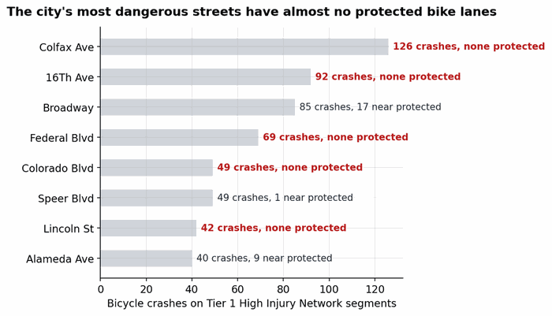
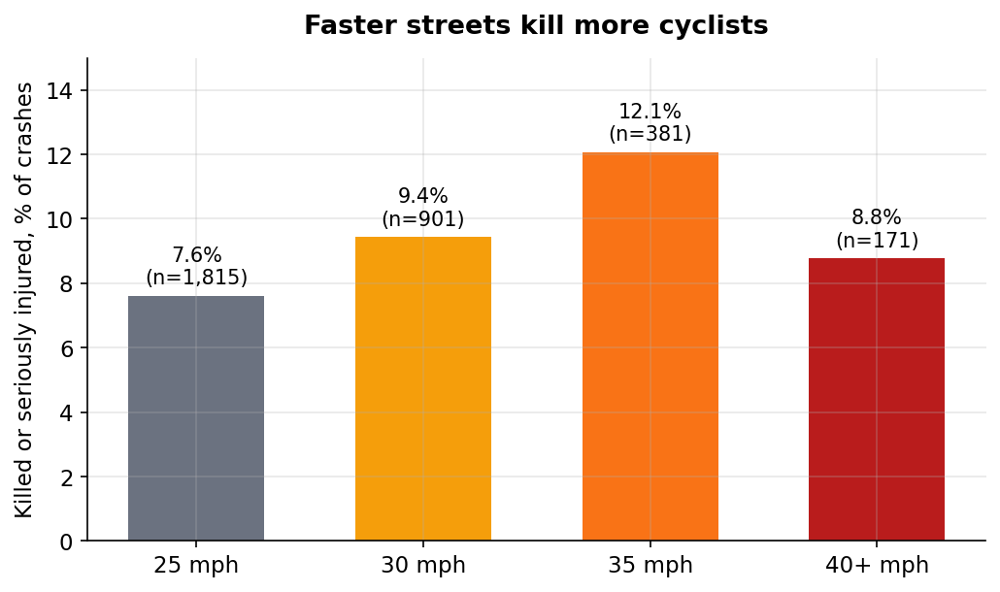
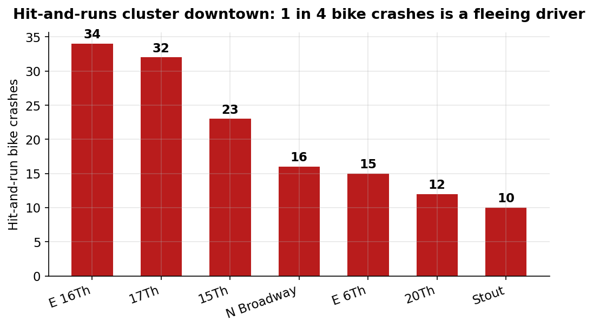

# Where Denver Cyclists Get Hit: A Data Brief

*What 3,521 police-reported bike crashes, the city's bike network, and its own High Injury Network say about cycling safety - and why the dangerous streets are already mapped.*

## The bottom line

Denver knows exactly where cyclists get hit. Its Vision Zero program mapped the city's most dangerous streets years ago. But **4 out of 5 bike crashes happen where no bike infrastructure exists**, and the deadliest corridors have almost nothing: Colfax Avenue has 126 bike crashes on a Tier 1 High Injury Network segment with zero protected lanes. Colorado Boulevard has 49 crashes and no bike infrastructure of any kind. This is not a data problem. It is a priorities problem.

## Finding 1: The network covers almost none of the danger

Of 3,521 bicycle-involved crashes reported to Denver Police from 2013 through October 2026:

- **2,761 (80%)** happened more than 25 meters from any completed bike facility
- **211 (6%)** happened near a protected bike lane - Denver has only 23 completed protected segments citywide
- Adjusted for when facilities were actually built, just **13.9%** of crashes occurred on infrastructure that existed at the time

Meanwhile, **1,385 planned bike segments sit unfunded**. The city has a build list. It is not building it.

**A note on what this does not prove.** Severity rates look flat whether crashes happen on or off infrastructure (8.4% vs 8.6% killed-or-seriously-injured). That does not mean lanes fail - it means the network is too small to evaluate that way, and we have no ridership data to compute per-trip risk. The honest headline is the coverage gap: four in five crashes happen where nothing exists.

## Finding 2: The city mapped the danger - then did not protect cyclists on it

**39.9% of all bike crashes fall on Denver's own High Injury Network** (23.2% Tier 1, 16.7% Tier 2). Every one of the five deadliest bike corridors is on it:

| Corridor | Bike crashes | Killed / seriously injured | On HIN | Near protected lane |
|---|---|---|---|---|
| Colfax Ave | 126 | 16 | Yes (Tier 1) | 0 |
| 16th Ave | 92 | 8 | Yes (Tier 1) | 0 |
| Broadway | 85 | 7 | Yes (Tier 1) | 17 |
| Federal Blvd | 69 | 7 | Yes (Tier 1) | 0 |
| Colorado Blvd | 49 | 6 | Yes (Tier 1) | 0 |
| Lincoln St | 42 | 8 | Yes (Tier 1) | 0 |

Broadway is the exception that proves the rule: 25.9% of its bike crashes are near infrastructure, the highest of any top corridor. Protection follows investment, not danger.

## Finding 3: Speed is the mechanism

Kill-and-serious-injury rates climb with posted speed: **7.6% at 25 mph, 9.4% at 30, 12.1% at 35**. (The dip at 40+ reflects limited-access roads cyclists rarely use.)

On fast arterials (35+ mph), the combination is lethal: **525 crashes at an 11.4% KSI rate**, with only 23.6% near any bike facility and **3.8%** near a protected lane. Fast roads with no protection are where cyclists die.

## Finding 4: One in four drivers leaves

**854 of 3,521 bike crashes (24.3%) were hit-and-runs.** They cluster hard downtown: E 16th Ave, 17th St, 15th St, and N Broadway lead the city.

## Finding 5: The COVID dip is over

Annual bike crashes fell from ~320 (2013-2018) to 160 in 2021, then rebounded: **217 in 2025** with a clean seasonal curve (not a reporting artifact), and 2026 is on pace for roughly 270 through October 7. The problem is growing back faster than the network.

## What would actually work

1. **Build protected lanes on Tier 1 HIN corridors with high bike crashes, in this order:** Colfax Ave, 16th Ave, Colorado Blvd, Lincoln St, Federal Blvd. The city has already done the analysis identifying these streets. The next step is concrete, not another study.
2. **Fund the unfunded.** 1,385 planned bike segments are sitting in the dataset with no money behind them. Pick the ones on the High Injury Network first.
3. **Treat hit-and-run as the enforcement priority it is.** A 24% flee rate concentrated downtown is a policing problem with a geographic answer.

## Methods & caveats

- **Crashes:** Denver Police "Traffic Accidents" dataset via the city's ArcGIS Hub, 2013-01-03 to 2026-10-07, filtered to `bicycle_ind=1` (3,521 records; 3,450 with coordinates). Severity and hit-and-run rely on officer coding; minor bike crashes are widely underreported, so these are floors.
- **Infrastructure:** "Open Data Bike Facilities" (2,025 segments), filtered to completed status for the coverage analysis; 23 completed protected-lane segments. Network is the 2026 snapshot; a time-aware variant (facility existed at crash date) gives 13.9% on-infrastructure.
- **Spatial matching:** 25m snap threshold throughout; each crash assigned to its nearest facility segment, HIN segment, and street centerline. Intersection crashes may snap to a crossing street. 71 crashes (2%) lack coordinates and are excluded from spatial stats.
- **High Injury Network:** Denver's published Vision Zero HIN (496 segments, Tier 1/2 per the city).
- **Speed:** posted SPEEDLIMIT from street centerlines; segments with missing/zero limits excluded from speed tables. The FUNCLASS field is unreliable (55% of segments default to "Major Coll-Rural" inside Denver) and was not used for conclusions; speed + volume class are the trustworthy fields.
- **No ridership data:** all rates are per-crash, not per-trip. We cannot say which corridors are most dangerous per cyclist, only where the most crashes happen.
- **21 fatal crashes** remain coded "UNDER INVESTIGATION" for fatality mode; the bicyclist death count may rise.

*Data: Denver Open Data Catalog - Traffic Accidents, Bike Facilities, High Injury Network, Street Centerlines. Analysis code and aggregated data: https://github.com/adowlen/denver-bike-safety-data-brief*
